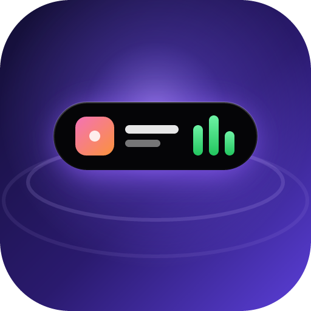

<p align="center">
  
</p>

<h1 align="center">NotchWin</h1>

<p align="center">
  A Dynamic-Island-style notch for Windows.<br/>
  It shows what's playing, your notifications, system stats and weather, and it has a voice assistant.
</p>

<p align="center">
  
  
  
</p>

---

## Features

| | |
|---|---|
| 🎵 **Now playing** | Spotify, YouTube, YouTube Music, Netflix, VLC… with cover art, controls, progress and a dancing equalizer |
| 🔔 **Notifications** | Important ones pop up briefly, then tuck into a bell. Click one to open its app |
| 🎮 **Game aware** | Announces games as they launch and gets out of the way while you play |
| 🔴 **Streaming** | A LIVE / REC dot from OBS, plus mic and camera in-use dots |
| 📊 **System** | CPU, RAM, GPU, network speed and ping |
| 🌦️ **Weather** | Shows the local weather automatically, no key needed |
| 🎙️ **Voice assistant** | "computer, play blinding lights": offline speech recognition, plus optional AI (Groq has a free plan) |
| 🎨 **11 themes** | Midnight, Nightfall, Aurora, Sunset, Ocean, Neon, Sakura, Ember, Glass, Daylight, and **Vibe**, which matches your album art |
| 🖱️ **Movable** | Drag it anywhere. It docks as a notch at the top edge or floats as a pill elsewhere |
| 🪶 **Lightweight** | Stats are only measured while it's open, animations only run while visible, and spare memory is handed back |

## Install

### Easiest: ready-made download (no .NET needed)

1. Go to the **[Releases](../../releases)** page and download `NotchWin-…-win-x64.zip`.
2. Unzip it and double-click **`Install NotchWin.bat`**.

Windows SmartScreen may warn you because the app isn't code-signed. Click **More info → Run anyway**.

### From the source code

1. Install the [.NET 10 SDK](https://dotnet.microsoft.com/download) (x64).
2. Download or clone this repo and double-click **`Install NotchWin.bat`**. It builds the app and then installs it.

### What the installer does
- installs to `%LocalAppData%\Programs\NotchWin` (no admin rights needed)
- adds **NotchWin** and **NotchWin Settings** to the Start menu, plus a desktop shortcut
- starts NotchWin when you sign in
- shows up under **Settings → Apps → Installed apps**, so you can uninstall it from there

To update, run the installer from the new version. Your settings are kept.

**Requirements:** Windows 10 (2004 or later) or Windows 11, 64-bit (x64).

## Using it

| Do this | Get this |
|---|---|
| **Hover** over the notch | It expands into a dashboard |
| **Drag** it | Moves it. Drop it at the top edge to dock it |
| **Right-click** it | Settings, Ask assistant, *Treat "app.exe" as a game*, Move back to top centre, Restart, Quit |
| **Click a pop-up** | Dismisses it |
| **Click the bell** (in the expanded view) | Shows your notifications |
| Say **"computer …"** or press **Ctrl+Alt+Space** | Talk to the assistant |

**Quit:** right-click → **Quit**. **Start again:** use the desktop shortcut or the Start menu ("NotchWin").
Opening it while it's already running brings up Settings.

### Voice commands

| Say… | What it does |
|---|---|
| "play blinding lights" / "can you put on ipad" | Plays it on YouTube Music |
| "play lofi beats on youtube" / "…on spotify" | YouTube instead, or a Spotify search |
| "pause" / "resume" / "next" / "previous" | Controls whatever is playing |
| "volume up" / "volume down" / "mute" | System volume |
| "open discord" / "open youtube" | Opens your shortcuts, any Start menu app, or common sites |
| "search for rtx 5070 price" | Runs a Google search |
| "what time is it" / "what's the weather" | Answers out loud |
| Anything else | Asks the AI, if you've added a key |

## Settings

Right-click the notch → **Settings**, or launch **NotchWin Settings** from the Start menu.

| Tab | What's there |
|---|---|
| **Notch** | Position, when to hide (games only / any fullscreen / never), size, hover delay, what the pill shows, start with Windows |
| **Themes** | 11 themes with live preview |
| **Voice & AI** | Voice mode (always listening / hotkey only / off), wake words, speech model, and the AI provider: **Groq (free)**, Grok, Claude, or any OpenAI-compatible server |
| **Weather & Streaming** | City (or auto-detect) and °C/°F, plus the OBS WebSocket port and password |
| **Notifications** | Which apps and keywords pop up, and pop-up timing |
| **Games** | Extra game exes, ignored exes, and game library folders |
| **Shortcuts** | The tiles in the expanded view |

Settings are stored in `%AppData%\NotchWin\config.json`, on your PC only.

## Privacy

- **Speech recognition** runs offline on your PC (Vosk). Nothing you say is sent anywhere unless the AI is turned on, and then only the sentence after the wake word goes to the AI provider you chose.
- **Notifications** are read locally from Windows' own notification database and never leave your PC.
- **Network use:** the weather comes from Open-Meteo (it uses your approximate location, from your IP address via ipwho.is, unless you set a city). The voice model is downloaded once from alphacephei.com. "Play …" commands look the song up on YouTube.

## Building & releasing (for developers)

```
dotnet run -c Release                     # run from source
dotnet publish -c Release -o out          # build a copy you can keep
```

Every push to GitHub is built automatically (the **Actions** tab), so you see straight away if something doesn't compile.
To publish a download for other PCs, push a version tag:

```
git tag v1.5.0
git push origin v1.5.0
```

GitHub Actions then builds a self-contained zip (no .NET needed on the target PC) and attaches it to a new release on the **Releases** page.

### How it's built

| Feature | File | How |
|---|---|---|
| Window & animations | `MainWindow.xaml(.cs)` | A transparent, always-on-top WPF window. Only the notch catches clicks, it's hidden from Alt+Tab, and it never takes focus |
| Themes | `Themes.cs` | Colour sets applied as WPF resources. *Vibe* picks the most vivid colour from the cover art |
| Now playing | `Services/MediaService.cs` | The Windows media API (the same source as the volume flyout). Browser tab titles tell it whether it's YouTube or YouTube Music |
| Stats | `Services/SystemStatsService.cs` | Win32 calls plus the "GPU Engine" performance counters |
| Weather | `Services/WeatherService.cs` | Open-Meteo |
| Games | `Services/GameWatcher.cs` | The Game Bar game list plus game library folders. Hides while a game is the window in front |
| LIVE / mic / camera | `Services/StreamService.cs` | The OBS WebSocket v5, plus Windows' privacy "in use" records |
| Notifications | `Services/NotificationService.cs` | Watches Windows' notification database (read-only) |
| Voice | `Services/VoiceAssistant.cs`, `CommandRouter.cs` | Vosk with NAudio for listening, Windows voices for talking back |
| AI | `Services/AiClient.cs` | OpenAI-compatible APIs (Groq, Grok, custom), plus the Anthropic API |
| Settings | `SettingsWindow.xaml(.cs)` | WPF's built-in Windows 11 dark theme |

## Troubleshooting

- **Doesn't start with Windows:** open Task Manager → **Startup apps** and make sure NotchWin is *Enabled*.
- **A game isn't detected:** with the game in front, right-click the notch and choose **Treat "game.exe" as a game**.
- **"Play …" opens the song paused:** play anything on music.youtube.com once so your browser allows autoplay.
- **The voice assistant mishears a song:** say the artist too, or add a free Groq key so the AI can correct it.
- **No notifications:** Windows doesn't create them while Do Not Disturb or Focus is on.
- **Anything else:** Settings → About → **Open log**.

## License

[MIT](LICENSE)
